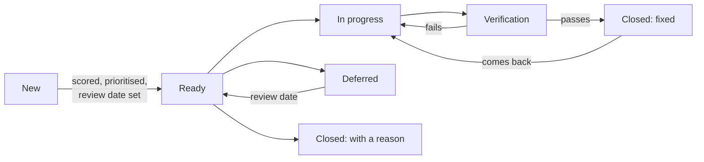

# Impact-led bug management: a playbook

We don't aim for zero bugs. We aim for bugs that do little harm, get fixed fast when they matter, and never sit in the backlog without a decision. Every bug gets an impact score for the harm it does to users. The score sets how fast we act and who looks at it, and it feeds the team's decision about what to fix first. It doesn't make that decision.

> **Disclaimer:** this is a comprehensive strategy, written to show the full picture. Most teams won't need all of it. Simplify it to fit your team's way of working (Scrum or Kanban), your tools and your internal processes. The thresholds, labels, meetings and dashboard panels are examples to adapt, not rules. A good place to start: impact scoring, triage within 2 days, a weekly look at urgent bugs, and a review date on every deferral. Add the rest only when it solves a real problem. This is a personal portfolio project; it doesn't describe any employer's process, and all data is fictional.

This playbook is for everyone who touches bugs: QA, developers, product managers and owners, engineering managers and leadership. If you only read one section, read [On one page](#on-one-page). For what it means for your role, see the [role guides](role-guides.md).

## Contents

- [On one page](#on-one-page)
1. [Why counting bugs doesn't work](#1-why-counting-bugs-doesnt-work)
2. [Goals, and how we know we're meeting them](#2-goals-and-how-we-know-were-meeting-them)
3. [Scoring impact](#3-scoring-impact)
4. [What each impact level means in practice](#4-what-each-impact-level-means-in-practice)
5. [The life of a bug](#5-the-life-of-a-bug)
6. [The rhythm: triage and reviews](#6-the-rhythm-triage-and-reviews)
7. [Who does what](#7-who-does-what)
8. [Making decisions visible](#8-making-decisions-visible)
9. [Bugs and tech debt](#9-bugs-and-tech-debt)
10. [Prevention: learning from what we fix](#10-prevention-learning-from-what-we-fix)
11. [Using AI, with a human in charge](#11-using-ai-with-a-human-in-charge)
12. [Keeping the numbers honest](#12-keeping-the-numbers-honest)
13. [Rolling it out](#13-rolling-it-out)
14. [Decision log and open questions](#14-decision-log-and-open-questions)

---

## On one page

**The goal:** keep the harm bugs cause small, visible and decided on. Not zero bugs.

**Five rules everyone follows**

1. **Every bug is triaged within 2 days.** Triaged means the team has reviewed it (label `bug-reviewed`) and scored its impact from how bad it is and how many users it reaches. It has an agreed priority, its reproducibility is checked, and it has a next review date.
2. **Urgent bugs are fixed or mitigated fast.** High within 14 days, Very high within 7. They are reviewed every week (Very high: every day until fixed or mitigated).
3. **No bug gets old without a decision.** At its age limit, a bug must be in progress, deferred with a reason and a date, or closed with a reason.
4. **Nothing goes live with a known urgent bug unless someone signs it off.** The sign-off records who decided, why, how users are protected, and what was promised by when. Some risks can't be signed off by anyone: an active incident, a known safety risk, an unmitigated security vulnerability or a confirmed legal or regulatory breach blocks go-live. In Scrum this is the sprint release or milestone; in Kanban, when a feature goes live for everyone or an epic is closed.
5. **We agree priority together, and emergencies come first.** QA, developers and the product owner agree when each bug is worked on. P0 emergencies stop other work; then come the team's agreed priorities; then planned work.

**Scores inform decisions; they don't make them.** The matrix gives everyone the same starting point. The team still weighs evidence, effort, cost of delay and what else would have to wait (see [scoring impact](#3-scoring-impact)).

**How we'll know it's working:** four numbers, one per goal, reviewed every month (see [section 2](#2-goals-and-how-we-know-were-meeting-them)) and shown on the [dashboard](https://alexandrabadescu.github.io/impact-led-bug-management/dashboard/).

---

## 1. Why counting bugs doesn't work

Counting bugs treats a typo the same as a customer being charged twice. That leads to familiar problems:

- **The backlog grows and nobody decides.** Old bugs stay open "just in case", so the list stops being useful.
- **Priority becomes a debate.** Without a shared way to score bugs, the loudest voice wins.
- **Old bugs turn into tech debt by accident.** Nobody chose to accept the risk; it just happened.
- **Good news can hide bad news.** "We closed 40 bugs" says nothing about whether users are better off.

Scoring by impact fixes the language problem: product, engineering and QA all talk about harm to users, not ticket counts.

## 2. Goals, and how we know we're meeting them

| Goal | The one number we watch | Target | Where to see it |
|---|---|---|---|
| **G1. Urgent bugs are fixed or mitigated quickly** | Share of High and Very high bugs fixed or mitigated within target, of those finished in the last 90 days, always shown beside the urgent bugs still open past target | At least 80%, and none open past target | Dashboard: This month, and This week |
| **G2. Weighted backlog exposure goes down** | Weighted exposure of open bugs (Very high 8, High 4, Medium 2, Low 1), compared with 4 weeks ago and with last quarter, always shown with the counts by level | Lower than before | This month |
| **G3. No bug gets old without a decision** | Open bugs past their age limit without a decision: no plan recorded, or escalated and waiting for leadership | 0 | Today, and This month |
| **G4. Every deferral is a recorded decision** | Deferred bugs with no reason, no review date, or an overdue review | 0 | This month |

Every number says what it covers and what it leaves out. G1, for example, can only rate work that's finished, which is why the bugs still open past target sit right beside it: a good rate must never hide overdue work.

**Supporting numbers**, which explain the four goals but are never targets on their own: bugs created and fixed per week, bugs closed without a fix, reopen rate, where bugs are found (before release or in production), root causes, and bugs not yet scored.

## 3. Scoring impact

**Impact combines severity and reach.** Read it from the matrix below, then adjust for exceptional risk. It's a lookup, not a multiplication. It measures harm to users, not how hard the fix is, and it is never about blame. The full guide, with worked examples, is in [scoring-guide.md](scoring-guide.md).

**Severity: how bad is it for the people affected?**

| Level | Meaning |
|---|---|
| Very high | A core journey is impossible, money or data is lost or exposed, or there's a safety or compliance risk with no workaround |
| High | A major function is broken or a key journey is blocked, including for people using assistive technology (for example, a WCAG 2.2 AA failure on checkout) |
| Medium | Something is degraded or awkward, usually with a workaround |
| Low | Cosmetic; nothing stops working |

**Users affected: how many people run into it?**

| Level | Share of users |
|---|---|
| Very large | Over 25%, or everyone |
| Large | 10 to 25%, or most people on one key journey |
| Medium | 1 to 10%, or one group: a device, browser, role or market |
| Low | Under 1%, a rare setup |

**The matrix**

| Severity ↓ / Users → | Low | Medium | Large | Very large |
|---|---|---|---|---|
| **Very high** | Medium | High | Very high | Very high |
| **High** | Medium | High | High | Very high |
| **Medium** | Low | Low | Medium | Medium |
| **Low** | Low | Low | Low | Medium |

**Three adjustments**
- **Raise one level** for safety, legal or regulatory exposure, money at risk or a critical group of users. Write the reason on the ticket. Accessibility failures need serious treatment, but their weight depends on the journey: a keyboard trap at payment is not the same as a contrast issue on a help page. Score the journey, not the checklist.
- **A safe workaround caps severity at Medium**, unless safety or compliance is involved.
- **Re-score when things change:** after a mitigation, when the workaround stops working, when support volume rises, or when usage changes.

**Not scored yet is not the same as low.** Bugs without a score are shown separately on every view, so they can't hide.

**Weighted exposure: what the 8, 4, 2, 1 mean, and what they don't.** To see whether open risk is building up, each open bug adds a weight by level: 8 for Very high, 4 for High, 2 for Medium, 1 for Low. The weights double at each level so that one serious bug outweighs a handful of small ones, and so the arithmetic is easy enough to do in your head. That's all they are: a ranking convention. They don't measure money, customers or harm, and one Very high bug is not "equal" to eight Low ones; a team that fixes eight typos instead of a payment bug hasn't done the same work. Two things can move the total without anything getting safer: closing bugs without a fix, and re-scoring them lower. So the dashboard always shows the counts by level next to the total, closures without a fix are counted apart from fixes, and every re-score is recorded with a reason.

**How days are counted.** One rule everywhere, on the dashboard and in the Jira filters: the day a bug is raised is day 0, and a limit of N days is met through day N and missed from day N + 1. A High bug raised on 1 October is on time through 15 October and late from 16 October. A review date is met on the day and overdue the day after.

**The score informs the decision; it doesn't replace judgement.** Two bugs with the same impact can deserve very different treatment. At triage, also weigh how confident the evidence is, the cost of waiting (a release next week, a seasonal peak), how well a mitigation would work, the effort, any customer or contractual commitment, and what other work would be pushed out. Write the reason when priority differs from what impact suggests. The [scoring guide](scoring-guide.md#using-the-score-a-worked-prioritisation) has a worked example.

## 4. What each impact level means in practice

| Impact | Points | Fix or mitigate within | Review | Needs a plan by | Leadership decides at |
|---|---|---|---|---|---|
| **Very high** | 8 | 7 days | Daily, until fixed or mitigated | 30 days | 90 days |
| **High** | 4 | 14 days | Weekly | 30 days | 90 days |
| **Medium** | 2 | Planned, or deferred with a date | Monthly | 90 days | 180 days |
| **Low** | 1 | Linked to planned work, or closed | Quarterly | 180 days | Not escalated: link it or close it |

Plus two team-level limits:
- **Triage within 2 days** of a bug being raised.
- **No more than 3 urgent bugs in progress per team** at once. Finishing beats starting.

**These are starting values for a pilot, not fixed rules.** Teams differ in size, maturity and delivery model, so treat each number as a hypothesis and change it when the evidence says so:

| Starting value | Change it if… |
|---|---|
| Fix or mitigate within 7 days (Very high) and 14 days (High) | The pilot's median is far inside or outside it, or most misses are for the same reason (a slow deploy pipeline, a supplier) |
| Triage within 2 days | Bugs regularly wait longer without harm (relax it), or urgent bugs are found late in the queue (tighten it, or triage daily) |
| 3 urgent bugs in progress per team | A small team can't run 3 at once, or a large one regularly has more without delay |
| Review every day, week, month, quarter | Reviews find nothing has changed (less often), or problems are found late (more often) |
| 15 to 25% of work for bugs and tech debt | Weighted exposure keeps rising (more), or the reserved share goes unused for two months (less) |

Record every change in the [decision log](#14-decision-log-and-open-questions).

**If nobody picks up an urgent bug.** A P0 gets someone straight away: the engineering manager or on-call assigns it and tells the product owner, because other work may stop. Any other High or Very high bug with no assignee 2 days after triage gets the `needs-pickup` label, and the engineering manager and product owner are told. They agree who picks it up at the next stand-up, and if that means pausing planned work, the product owner decides what moves, because that's a roadmap trade-off. If it then passes its fix target, the QA lead raises it at the weekly urgent review and the product owner tells stakeholders. If it's still open at the leadership age, leadership decides, in writing, fix next milestone or accept the risk. Until they do, it shows as "leadership decision pending", because escalating isn't deciding. The QA lead brings the options; leadership records the decision on the ticket by the next monthly review.

Nobody is blamed for an urgent bug sitting unpicked. It usually means the team is at capacity, and that's a conversation for the engineering manager and product owner.

**Two thresholds, two decisions**
- **"Needs a plan by"** is the team's decision: start it, defer it with a reason and a date, or close it with a reason.
- **"Leadership decides at"** is for urgent and medium bugs still open and not mitigated. Leadership chooses: fix it in the next milestone, or accept the risk in writing.

**Mitigation counts.** A rollback, a feature flag, a fallback, a guard or a workaround that protects users meets the "fix or mitigate" target. Record the date users were first protected (a rollback within the hour counts from that hour, not from when the permanent fix ships), and how much the mitigation protects them:

| Mitigation type | Example | What it means for the score |
|---|---|---|
| **Removes the risk** | Rolling back the release that caused it; turning the feature off | No user can hit it now. Re-score to reflect the residual risk, usually Low |
| **Reduces the risk** | A job that re-runs stuck checks every 15 minutes; blocking an action with a clear message | Fewer people affected, or less harm. Re-score with the reason |
| **Relies on a manual step** | Support fixes records by hand; finance sends corrected receipts on request | Protection depends on people noticing and acting. Re-score cautiously, and review more often |

Then plan the real fix as tech debt.

### Impact and priority: what we fix first

**Impact** says how much harm a bug does. **Priority** says when we work on it. Impact suggests a starting priority. At triage, QA, a developer and the product owner agree the priority together, and can move it up or down for a good reason: a release date, a dependency, a customer commitment, or a cheap fix in code someone is already changing. Write the reason on the ticket.

| Priority | What happens | Usually |
|---|---|---|
| **P0: emergency** | Stop current work. The people needed swarm until it's fixed or mitigated, then plan the full fix. | Very high in production; an incident; money, data, safety or compliance at risk right now |
| **P1: next up** | Ahead of new feature work in the current sprint, within the fix target | High; Very high found before release (it blocks that release) |
| **P2: planned** | Scheduled into a sprint, milestone or tech debt window | Medium; the structural fix after a mitigation |
| **P3: later** | Linked to planned work, or looked at again on its review date | Low; deferred bugs |

**Anyone can call a P0.** The engineering manager or on-call engineer confirms it within the hour, and the product owner tells stakeholders. Calling a P0 that turns out not to be one is fine; missing a real one isn't.

**How developers pick up bugs**
1. **P0 emergencies first.** Drop what you're doing and join the swarm, if you're needed.
2. **Then the team's agreed order.** P1 bugs in the order agreed at triage or sprint planning, alongside the planned feature work.
3. **Then planned decisions.** P2 bugs scheduled for this sprint, milestone or tech debt window.
4. **Fix while you're there.** A small bug in code you're already changing can be fixed in the same pull request. Tell QA so it gets verified and closed.

Picking bugs from the backlog by personal preference skips the trade-offs the team agreed. If a bug looks more important than its priority, raise it at triage or in the team channel; that's how priorities get better.

## 5. The life of a bug

| State | It's in this state when… |
|---|---|
| **New** | It was raised using the [bug template](bug-template.md): clear steps, expected and actual behaviour, evidence. |
| **Ready** | It has been triaged: impact scored with a one-line reason, priority agreed, and a next review date. The owner is the team whose board it's on. This is a bug's "definition of ready". |
| **In progress** | Someone is fixing or mitigating it. Urgent bugs count towards the team's limit of 3. |
| **Verification** | A fix is deployed to a test environment, with the pull request linked. Someone other than the developer who fixed it checks it on the browsers, devices and locales it affected, and adds a regression check if one is missing. How independent that check is depends on the risk: QA verifies High and Very high bugs and risky changes; a peer developer is fine for Low and Medium. |
| **Closed: fixed** | Verified. A cause label is added if the cause is known; it's optional. |
| **Closed: with a reason** | Duplicate (linked); not reproducible (two real attempts, evidence of what was tried, and nothing left pointing to a real problem); or risk accepted in writing, for Low and Medium only. |
| **Deferred** | A conscious decision not to fix now. Needs a reason from a fixed list and a review date; a workaround is noted if there is one. It stays open and counts in weighted exposure. Two kinds of deferral matter most: a High or Very high risk that leadership accepts stays here (reason "Risk accepted"), never closed, so it stays visible; and a bug that can't be reproduced yet but still looks real (production-only, customer-reported, intermittent) stays here with "Monitoring for more evidence", logging added and a review date. |

**Where bugs come from:** QA and automated tests, developers, customer support, production monitoring and incidents. Support volume and monitoring data feed into "users affected", so the score is based on evidence, not a guess. A production incident is scored with the same model, so incidents and bugs are compared fairly.

## 6. The rhythm: triage and reviews

| Event | When | Who | What goes in | What comes out |
|---|---|---|---|---|
| **Triage** | Twice a week, 20 minutes, or async within 2 days | QA, a developer and the product owner, together (QA keeps it on time) | New bugs not yet reviewed | Every bug scored, prioritised, checked for reproducibility and dated, with the `bug-reviewed` label |
| **Urgent bug review** | Weekly, 15 minutes | QA lead, engineering managers and product owners (QA lead facilitates) | High and Very high bugs; overdue reviews | A next step and an owner for every urgent bug; escalations raised |
| **Prevention review** | Monthly, 30 minutes | QA lead, engineering managers, product owners, and the developers who fixed the bugs discussed | Fixed High and Very high bugs; reopened bugs; hotspots | One or two prevention actions with owners and dates |
| **Trade-off review** | Quarterly, 45 minutes | Product, engineering and QA leads | The four goals; deferred bugs; tech debt | A short list of bugs we commit to fix; tech debt priorities; changes to limits in this playbook |

Keep the meetings short by doing the scoring before them. The [dashboard](dashboard-guide.md) has one view per meeting.

## 7. Who does what

Bugs are a team problem, not a QA queue. Nobody throws a bug over the wall: the people closest to each decision make it together, and one person keeps it moving.

QA facilitates; it doesn't own every decision. QA keeps triage on time, brings the risk view and verifies where the risk calls for it. Scores, closures and workflow changes belong to the team, with independent checks in proportion to the risk. A process that only works when QA is in the room becomes a bottleneck.

**How we work together**
- **Triage is a conversation, not a hand-off.** QA brings the evidence, the developer brings what it would take, the product owner brings what matters to users and the business. Together they agree impact, priority and owner.
- **Anyone can raise a bug, and anyone can challenge a score.** Disagreement at triage is useful; it's how the scoring guide gets better.
- **Fixing and verifying go side by side.** The developer and QA agree how the fix will be checked before it's built, and pair on tricky reproduction.
- **Decisions to defer or accept risk are shared.** Product and engineering decide together, with QA's view of the risk on the ticket.
- **Prevention belongs to everyone.** The monthly review picks actions; any role can own one.

| Activity | Who works on it together | Who keeps it moving | If we can't agree |
|---|---|---|---|
| Raise a bug with the template | Anyone: QA, developers, product, support | The person who found it | |
| Score impact and agree priority | QA, a developer and the product owner, at triage | QA facilitates | Settle it with evidence: logs, support volume, analytics. If still split, the product owner decides priority, and the disagreement on impact is noted on the ticket and brought to the next calibration |
| Call a P0 emergency | Anyone raises it; engineering manager or on-call confirms | Engineering manager | Treat it as P0 until confirmed otherwise |
| Fix or mitigate | Developers, with QA pairing on reproduction and checks | The developer who picked it up (the assignee) | Engineering manager, with the product owner |
| Verify the fix | The developer and QA agree the checks before the fix is built | Someone other than the developer who fixed it: QA for High and Very high or risky changes, a peer for the rest | |
| Defer a bug, or accept a risk | Product owner and engineering manager, with QA's risk view | Whoever records the decision on the ticket | Leadership, for High and Very high |
| Close without a fix | The product owner, with the reporter and whoever investigated | The person who investigated | Product owner |
| Go live with an open urgent bug | Product owner, engineering manager and QA lead, at go/no-go (Scrum) or before the feature goes live for everyone (Kanban) | Product owner records the sign-off | Leadership |
| Escalate a bug past its leadership age | QA lead, engineering manager and product owner bring options | QA lead | Leadership: fix next milestone, or accept the risk |
| Prevention actions | Whoever the monthly review agrees | The action's owner | |
| Keep the dashboard and this playbook current | Everyone suggests changes | QA lead | Quarterly trade-off review |

### When decisions stall

The process assumes people answer. They don't always, so these are the defaults. None of them needs a new meeting.

- **An escalation gets no answer.** Silence is never acceptance. The bug stays on the dashboard as "leadership decision pending", and the QA lead raises it at the next monthly review. If a second review passes with no decision, it goes one level up, and until then the team treats it as "fix next milestone", the safer of the two options.
- **Product and engineering disagree.** Each owns their half: the product owner decides priority, the engineering manager decides how and with what capacity. Both views go on the ticket. If the disagreement is really about accepting a High or Very high risk, that's a leadership decision anyway.
- **An urgent decision is delayed.** Protect users first, decide second. For a P0, the engineering manager or on-call can roll back, turn a feature off or mitigate without waiting for anyone; the trade-off conversation happens afterwards.
- **A risk has no owner.** It can't: the owner is the team whose board it's on. If that team no longer exists, the engineering manager for the area inherits it until it's re-homed.
- **The decision-maker is away.** Every role that decides names a deputy. For a P0, on-call decides.

### Where this meets other processes

This playbook sits next to processes that already exist. It doesn't replace them.

- **Incidents.** A P0 in production is also an incident. The incident process owns the response and communication; this playbook picks up the bug afterwards (score, mitigation date, permanent fix, prevention review). The `incident` label links the two.
- **Security.** Vulnerabilities follow the security team's process, severity scale and disclosure rules. They can appear on the dashboard, but they're never deferred or accepted through this playbook alone, and an unmitigated one blocks go-live.
- **Compliance, legal and safety.** A confirmed legal or regulatory breach, or a safety risk, isn't a trade-off for a product owner to sign off. It goes to the people accountable for it (compliance, legal, the safety lead), and it blocks go-live until they've decided.

**Ownership:** the **owner** of a bug is always the **team whose board it's raised on**, so ownership is never missing. The **assignee** is the developer who picks it up when work starts; P0 emergencies get one straight away, and High and Very high bugs should be picked up within 2 days. The assignee keeps it moving; they don't have to do all the work alone.

## 8. Making decisions visible

Every decision not to fix something now is written down where people will see it.

| Decision | Required on the ticket |
|---|---|
| **Defer** | Reason (required, from a fixed list: needs a bigger change, lower priority than the roadmap, planned with other work, workaround in place, waiting on another team or supplier, monitoring for more evidence, risk accepted), review date (required), and a workaround if there is one |
| **Accept the risk** | Who accepted it, why, and what would make us look again. Low and Medium can be closed; High and Very high stay open as a deferral with the reason "Risk accepted" and a review date, and only leadership can accept them |
| **Escalate** | The options brought to leadership, and leadership's decision (fix next milestone, or accept the risk) recorded on the ticket |
| **Close: not reproducible** | What was tried, on which environments, two attempts with the reporter, and why nothing points to a real problem any more |
| **Close: duplicate** | Link to the bug it duplicates |
| **Go live with an open urgent bug** | What went live (release, milestone, feature or epic), bug IDs, who signed off, why, how users are protected, and what was promised by when. Whether the promise was kept is read from the bug's history, not reported by hand |

**Why this matters:** "we chose to carry this risk" and "we forgot about this" look identical in a backlog. Writing the decision down is what makes the difference visible. It's also how the dashboard can show risk honestly. And a decision to carry a serious risk must never look like the risk was removed, which is why accepted High and Very high risks stay open.

## 9. Bugs and tech debt

- A bug becomes **tech debt** when the right fix is structural and users are already protected: it's mitigated, or its impact is Low. Link the bug and the tech debt item both ways.
- Tech debt items are sized and planned in the same backlog as features, not in a separate list nobody reads.
- **Plan a share of the work for bugs:** each team plans 15 to 25% of its work for bugs, tech debt and prevention, as a visible swimlane or ticket type. **Check it with the share of completed tickets** that were bugs or tech debt each month. Jira counts that with two saved filters, with no time tracking. It's a proxy: a one-line fix and a two-week investigation both count as one ticket. If the team already estimates in story points, the share of points is closer to effort. Don't add time tracking just to make this number prettier. The monthly review compares the planned share with the actual one, because a share that's planned but never checked disappears.
- **New initiatives start with a baseline:** list the known bugs in the area and their impact levels, and say whether the work should reduce, keep or increase them. **Nothing goes live** (a milestone or release in Scrum; a feature or epic in Kanban) with open urgent bugs linked to it, unless there's a sign-off (see section 8).

## 10. Prevention: learning from what we fix

Fixing a bug solves today's problem. Prevention stops the next one. But asking for a root cause on every ticket creates friction, and most of the data never gets used. So we keep it light and focus where it pays off.

- **No required fields, no blocked tickets.** Nobody has to fill in a root cause to move or close a bug.
- **A cause label, if someone knows it.** The developer who fixes a bug usually knows why it happened. If they do, they add one Jira label from a short list. Labels are built into Jira, show on every board and can be filtered and charted with no setup. QA isn't expected to know the cause.
- **The fix shows what was added.** The pull request linked to the ticket shows the test, check or alert that came with the fix. No separate field.
- **The real work happens at the monthly prevention review** (30 minutes). The team looks only at the bugs where learning matters most: **fixed High and Very high bugs, and anything reopened**. For each, the people who worked on it agree the cause, check something was added to stop it coming back, and add the label if it's missing. Then they pick one or two prevention actions with owners and dates.

**Cause labels** (keep the list short so the chart stays readable): `cause-requirement-gap`, `cause-integration-contract`, `cause-boundary-check`, `cause-untested-change`, `cause-cache-or-state`, `cause-data-migration`, `cause-race-condition`, `cause-test-data`, `cause-third-party`, `cause-accessibility`.

A Medium or Low bug fixed without a cause label is fine. If the same kind of bug keeps coming back, it'll show up in the reopened bugs or the hotspots, and the review will pick it up.

## 11. Using AI, with a human in charge

AI takes the preparation: drafting, checking, summarising and suggesting. People keep the judgement and the accountability: impact, priority, P0s, reproducing, verifying, risk decisions, sign-offs and causes.

### AI in the review process

| Stage | AI can do | Stays with people |
|---|---|---|
| **Raising bugs** | Investigate evidence and draft a ticket in the template, labelled `ai-drafted` ([bug-investigation skill](../skills/bug-investigation/SKILL.md)); check the draft is complete; suggest likely duplicates | Confirming the ticket is real and accurate, and the evidence is right |
| **Triage** | Suggest severity, users affected and impact, with its reasoning; suggest the area and related bugs | **Agreeing impact and priority**; **calling a P0** |
| **Reproducing** | Suggest steps from logs; suggest which tests or environments to try | **Actually reproducing it**, and setting `reproducible` or `not-reproducible` |
| **Flaky tests** | Find the cause of an intermittent failure and the smallest fix; say whether there's a real product bug ([flaky-test-analysis skill](../skills/flaky-test-analysis/SKILL.md)) | Deciding the fix; raising a bug only if it's real |
| **Weekly urgent review** | Prepare the agenda: urgent bugs, overdue reviews, what changed | Deciding next steps; **deferring, accepting risk or escalating** |
| **Fixing** | Suggest tests to add; review the pull request against the acceptance criteria | Code ownership and approving the merge |
| **Verifying** | Suggest the regression scope: browsers, devices, locales, related areas | **Verifying and closing** |
| **Go/no-go** | Summarise known open bugs for the release notes | **The sign-off** |
| **Monthly prevention review** | Prepare the list (fixed urgent bugs with no cause label, reopened bugs, hotspots); suggest likely causes from the fix | **Agreeing the cause**; choosing prevention actions and owners |
| **Reporting** | Draft the monthly summary from the dashboard | Interpreting it and deciding what to do |

### Stopping false or unclear AI bugs

1. **Only draft from evidence.** No evidence, no ticket: a failing test run, a log entry, a support ticket or an alert, always linked. Give the AI the acceptance criteria, feature flags, known issues and recent releases, because a lot of "bugs" are intended behaviour or a flag that's off.
2. **Rule out the usual false alarms first:**

| False alarm | Rule |
|---|---|
| Flaky test or broken environment | Only draft if the test fails twice and the environment health check passes |
| Expected behaviour | Check the acceptance criteria and flags; if unsure, ask instead of raising |
| Test data problem | Check whether the failure follows the data, not the code |
| Misread logs | Only errors that affected a user or a request, not warnings or retries |
| Duplicate | Search open bugs first; above a similarity threshold, comment on the existing bug |

3. **Make the draft show its working.** "Observed" (with evidence) and "Suspected" (a guess) are kept apart. A "Not confirmed" section says what the AI couldn't check. Impact is a suggestion with reasoning.
4. **Write for everyone.** The title says what fails, when and for whom, from the user's point of view. The description is two plain sentences. No internal jargon.
5. **Check every draft automatically.** [`tools/check-bug-draft.js`](../tools/check-bug-draft.js) checks the draft against the one [AI draft schema](bug-template.md#ai-drafted-bugs-the-same-template-with-four-changes): the title, sections, steps and evidence, that the impact follows the matrix, the labels (`ai-drafted` present, never `bug-reviewed`), and obvious personal data or secrets. A draft that fails goes back; it never reaches the backlog. The privacy checks are a basic safeguard, not a guarantee, so the person who accepts the draft still reads it.
6. **A person is the gate.** AI drafts land in intake, not the backlog, and only get `bug-reviewed` after a person confirms them at triage. Whoever accepts an AI draft owns its accuracy, like approving a pull request.
7. **Cap the volume.** A daily limit or batched drafts, so AI never floods triage. Ten good bugs beat fifty maybes.

### Is AI helping?

Two labels answer this (see the [labels guide](labels-guide.md)): `found-with-ai` (an AI tool helped find the bug) and `ai-drafted` (an AI tool drafted the ticket). The monthly dashboard view shows:
- **What happened to AI-drafted tickets at triage**, compared with tickets people wrote. Only tickets with an outcome count: accepted at triage, or closed as a duplicate or not reproducible. Tickets still waiting for triage are shown but left out of the rate, because they haven't been judged yet. Duplicates and not reproducible are shown separately: a duplicate means the AI didn't search well enough; not reproducible means its evidence didn't hold up, though an intermittent bug can still be real.
- **The impact of bugs found with AI.** Mostly Low means the tool is finding noise.

**Stop rule:** if more than 1 in 5 AI-drafted tickets with an outcome is rejected, pause AI drafting until the skill or prompt is fixed. The rule only applies once there are at least 10 outcomes; below that, the dashboard says "too few to judge", because one ticket would swing the rate by 10 points or more.

### Guardrails

1. **AI suggests; people decide.** AI never changes status, impact, priority or labels other than its own (`ai-drafted`), and never closes, defers or signs off a bug.
2. **Check the AI against known answers.** Keep a set of past cases with agreed answers, including traps (a duplicate, an intermittent bug, too little evidence). Run the AI against them before trusting it, and again after every prompt or model change. Track how often it matches. This repo has [eight such cases](../evals/bug-drafts/README.md), with an automated score for what can be checked mechanically and a rubric for what needs a person.
3. **Watch for drift.** If the match rate drops or the stop rule trips, pause until the prompt is fixed.
4. **Keep data private.** Only share what your organisation allows with AI tools. Remove customer personal data first.
5. **Measure learning, not people.** Review the AI numbers quarterly. Never compare people with AI, or people with each other.

## 12. Keeping the numbers honest

Any number that becomes a target can be gamed, usually by accident. These rules keep the dashboard honest:

- **Every rate shows what it leaves out.** A rate over finished work sits beside the open work it can't see, such as urgent bugs still past target.
- **A past date shows only what was known on that day.** Going back in time never shows a figure or a note that was written later.
- **Never read weighted exposure alone.** It can fall because bugs were fixed, or because bugs were closed without a fix or scored lower. The dashboard shows "closed without a fix" and re-scoring next to the trend.
- **Unscored bugs are shown, not counted as zero.**
- **Closing needs a reason.** A spike in "closed without a fix" gets a look at the monthly review.
- **Re-scoring is recorded** with a date and a reason, especially after a mitigation.
- **Score calibration:** once a month, the triage group scores the same five bugs separately and compares. Big differences mean the guide needs a clearer example.
- **These are team numbers, not people numbers.** They are never used to rate individuals. If people fear the numbers, they'll stop raising bugs.
- **"Found in production" is not an escape rate.** It's the share of new bugs found in production. A true escape rate needs every bug linked to the release that introduced it.

## 13. Rolling it out

Start small, learn, then scale. Thresholds and limits only get right through use. Start with the [minimum version](minimum-viable-approach.md); the [rollout plan](rollout-plan.md) has the phases, roles, dependencies, effort (as planning assumptions), decision points, success and rollback criteria, and the adoption risks to watch for.

**What we'll ask at the end of the pilot:** Were urgent bugs fixed or mitigated faster? Did the backlog shrink without hiding risk? How long did triage take? Did teams find the scores fair? Which starting values need to change?

### What I wouldn't implement everywhere

This playbook is deliberately complete, so it's easy to see how the parts fit. I wouldn't drop all of it onto a team on Monday morning and hope everyone thanked me. Some parts only pay off in certain teams:

- **The full dashboard.** A small team with a short backlog gets most of the value from a saved filter for urgent bugs and a weekly look. Build panels when someone needs the answer, not before.
- **Four meetings.** Triage and the weekly urgent review are the core. Monthly prevention and quarterly trade-off reviews can be one agenda item in an existing retro or planning session.
- **"Where are bugs caught?" and cause labels.** Worth it when you're deciding where to invest in automation or prevention; extra admin otherwise.
- **The AI skills and "Is AI helping?".** Only if the team already uses AI for bug work. Measuring an AI tool nobody uses is noise.
- **Go-live sign-offs in Kanban.** For a team that ships small changes behind flags many times a day, a sign-off per change is theatre. Sign off when a feature is switched on for everyone, not per deploy.
- **Fixed review cadences.** In a team where everyone looks at the board daily, a "quarterly review" of Low bugs can be a backlog clean-up twice a year.

The test for adding anything: does it solve a problem this team actually has?

## 14. Decision log and open questions

Every change to this playbook gets a line here, so people know which rules are in force.

| Date | Decision | Why | Decided by |
|---|---|---|---|
| _yyyy-mm-dd_ | _Example: High bugs: fix target changed from 14 to 10 days_ | _Pilot data showed a median of 6 days_ | _Product, engineering and QA leads_ |

**Open questions for the pilot**
- Is 3 urgent bugs in progress per team the right limit for every team size?
- Should Medium bugs have a fix target, or only a decision target?
- How much does support volume change the "users affected" score in practice?
- How long should leadership have to decide on an escalation before it's flagged? (Starting value: the next monthly review.)
- Are 10 outcomes enough before judging AI drafts, or should the team wait for more?

---

**Status:** an example playbook for a portfolio, written to be adapted. Replace the starting values with your own and run a pilot first.

© 2026 Alexandra Badescu. Licensed under [CC BY-NC-ND 4.0](../LICENSE).
