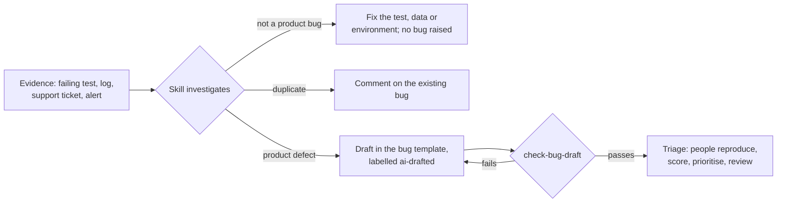

# AI skills for bug work

Two Claude skills I use for bug work, adapted to this playbook. They investigate first, and only draft a bug when the evidence shows a real product defect. Every draft follows the one [AI draft schema](../docs/bug-template.md#ai-drafted-bugs-the-same-template-with-four-changes), goes through an automatic check, and then a person at triage before it reaches the backlog.

| Skill | What it does | What it never does |
|---|---|---|
| [`bug-investigation`](bug-investigation/SKILL.md) | Investigates unexpected behaviour across requirements, UI, API, logs, code and data; classifies it (product defect, test problem, data, environment, configuration, requirement gap, expected behaviour, duplicate); drafts a bug in the team's template only for a product defect, with an impact **suggestion** and the labels to add | Raise, score, prioritise, defer or close anything; add `bug-reviewed`; put personal data in a draft |
| [`flaky-test-analysis`](flaky-test-analysis/SKILL.md) | Finds why an automated test fails intermittently and the smallest reliable fix; says clearly whether there's a real product bug, and hands it over to `bug-investigation` if there is | Add retries, waits or longer timeouts to hide a failure; raise a product bug for a test problem |

## How they fit the process

1. **Evidence in, or nothing happens.** Each skill works from something a person can open.
2. **Most findings aren't bugs.** Both skills are written to say so, which is the main defence against false bugs.
3. **Drafts are checked automatically.** `node tools/check-bug-draft.js draft.md` checks the title, the sections against the schema, the steps, the evidence, that the impact suggestion follows the scoring matrix, the labels, and obvious personal data or secrets. A failing draft goes back; it never reaches the backlog. The privacy checks are pattern-based, so they're a safety net, not a guarantee: the person at triage still reads the draft.
4. **People decide at triage.** They reproduce it, confirm or change the impact, agree the priority and add `bug-reviewed`.

## Keeping them honest

- **Known-answer checks.** [Eight fictional cases](../evals/bug-drafts/README.md) with agreed answers: a real bug, plus traps like a duplicate, an intermittent bug and too little evidence. Run the skill against them before trusting it, and again after every prompt or model change, then `npm run eval -- outputs/`.
- **Watch the numbers** on the dashboard's "Is AI helping?" panel: how often AI-drafted tickets are closed as duplicates or not reproducible, compared with tickets people wrote.
- **Stop rule.** If more than 1 in 5 AI drafts with an outcome is rejected, pause drafting until the skill is fixed. Judge it only once there are at least 10 outcomes.
- **What isn't tested here.** A test checks that the skill, the template and the checker list the same sections, and the known-answer cases' reference answers are tested. No real model output has been scored from this repo, because that needs a model call.

## Using them

Copy a skill's folder into your project's `.claude/skills/` folder, then run it with your evidence, for example `/bug-investigation checkout retry charges twice, trace 7f3a9c`. Both skills are invoked by a person (`disable-model-invocation: true`), never automatically.

---

© 2026 Alexandra Badescu. Licensed under [CC BY-NC-ND 4.0](../LICENSE).
